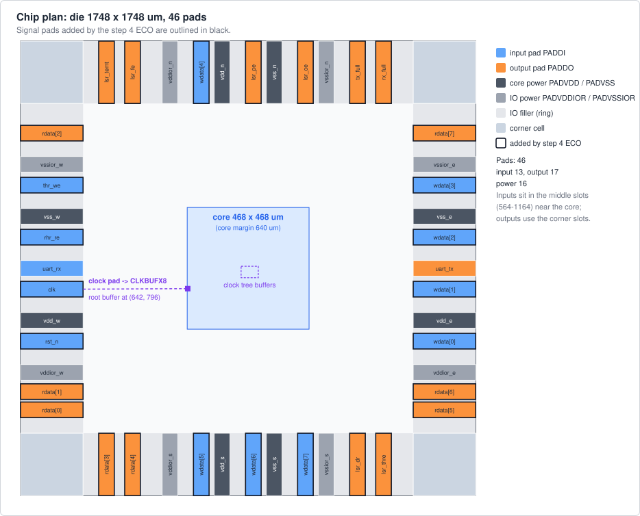
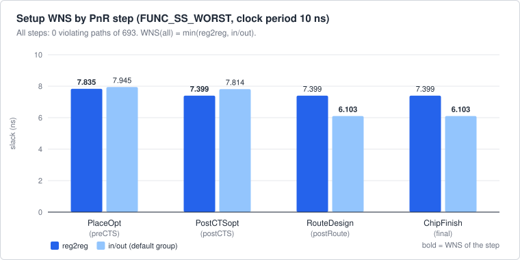
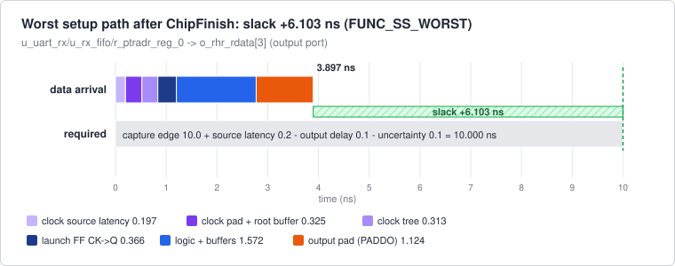
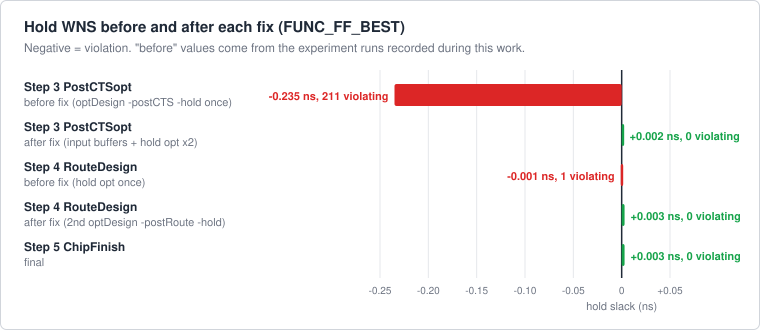
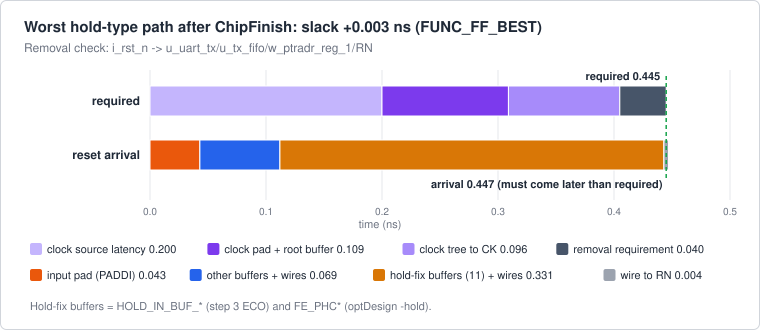
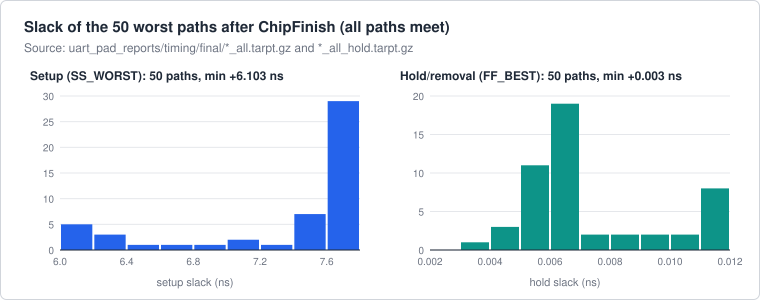
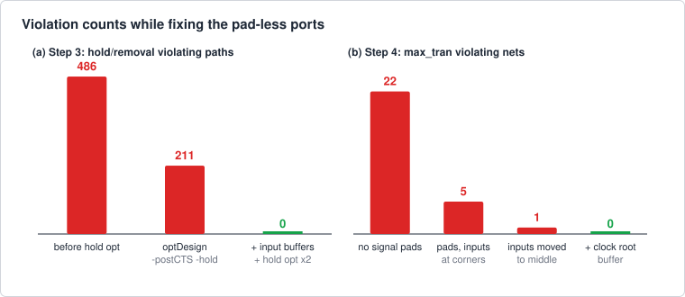

# PNR — UART 패드 칩 진행 상황

이 폴더에는 교재 원본(cmsdk) 스크립트 `0_InitDesign.tcl` ~ `6_ECO.tcl`과 UART 패드 칩 스크립트 `uart_pad/`가 함께 있다.
이 문서는 `uart_pad` 흐름의 진행 상황과 타이밍 결과를 정리한다. 기존 `README`는 Innovus를 `-stylus` 없이(legacy 모드) 실행하는 이유를 적은 메모다.

## 진행 요약

| 단계 | 스크립트 | 교재 2권 | 상태 | 주요 결과 |
|:---:|---|:---:|:---:|---|
| 0 | `uart_pad_0_InitDesign.tcl` | 3장 | 완료 | 다이 1748×1748㎛, 전원 패드 16개 배치 |
| 1 | `uart_pad_1_PowerPlan.tcl` | 4장 | 완료 | 연결 점검 40건 → 0 |
| 2 | `uart_pad_2_PlaceOpt.tcl` | 5장 | 완료 | setup WNS +7.835ns |
| 3 | `uart_pad_3_PostCTSopt.tcl` | 6장 | 완료 | hold 위반 211 → 0, setup +7.399ns |
| 4 | `uart_pad_4_RouteDesign_PowerAnalysis.tcl` | 7장 | 완료 | 시그널 패드 28개 ECO, max_tran 22넷 → 0, 전력 11.63mW |
| 5 | `uart_pad_5_ChipFinish.tcl` | 8장 | 완료 | setup +6.103ns, hold +0.003ns, DRC 0, GDS 출력 |
| - | `uart_pad_tempus.tcl` | 10장 | 대기 | Tempus STA, ECO 파일 생성 |
| 6 | `uart_pad_6_ECO.tcl` | 11장 | 대기 | `uart_pad/innovus.eco` 필요 |

모든 단계에서 setup 위반 0이고, 3단계 이후 hold 위반 0이다. 클록 주기는 10ns(100MHz)이며, setup은 `FUNC_SS_WORST`(0.9V, 125℃), hold는 `FUNC_FF_BEST`(1.1V, 0℃) 뷰로 분석한다.

## 칩 구성



- 다이 1748×1748㎛, 코어 468×468㎛ (코어 여백 640㎛). 다이 크기는 배치 격자(0.19㎛·0.2㎛)의 공배수로 정했다.
- 패드 46개
  - 전원 16개: 각 변에 PADVDDIOR·PADVDD·PADVSS·PADVSSIOR (`uart_pad.init.io`, PADVDD·PADVSS는 `placeInstance`로 배치)
  - 시그널 30개: RX·TX 2개는 합성 netlist에 포함되어 있고, 나머지 28개(입력 12, 출력 16)는 4단계에서 라우팅 전에 ECO로 추가한다 (그림에서 검은 테두리).
- 입력 패드는 코어에 가까운 각 변의 가운데 자리(564~1164㎛)에 두고, 출력 패드는 모서리 쪽 자리에 둔다. 입력 패드를 모서리에 두면 패드(PADDI)가 400㎛ 이상의 배선을 구동해야 해서 max_tran 위반이 남았다.
- 클록 패드에서 클록 트리 버퍼까지 약 630㎛이므로 코어 왼쪽 가장자리 (642, 796)에 루트 버퍼 CLKBUFX8(`u_clk_pad_buf`)을 둔다.

## Setup 타이밍

### 단계별 Setup WNS



- reg2reg 경로는 CTS 이후 +7.399ns로 변하지 않는다.
- 입출력(default 그룹) 경로는 4단계에서 +7.814ns → +6.103ns로 줄었다. 4단계에서 출력 패드(PADDO)를 추가해, 최악 경로가 출력 패드를 지나게 되었기 때문이다 (아래 그림에서 패드 구간이 1.124ns).
- 그래도 클록 주기 10ns의 약 61%가 여유로 남는다.

### Setup 최악 경로 (5단계 후)



- 경로: 수신 FIFO 읽기 포인터 `u_uart_rx/u_rx_fifo/r_ptradr_reg_0` → 출력 포트 `o_rhr_rdata[3]`
- 데이터 도착 3.897ns = 클록 경로 0.835ns (소스 지연 0.197 + 클록 패드·루트 버퍼 0.325 + 클록 트리 0.313) + 플립플롭 CK→Q 0.366ns + 로직·버퍼 1.572ns + 출력 패드 1.124ns
- 요구 시간 10.000ns = 다음 클록 에지 10.0 + 소스 지연 0.2 − 출력 지연 0.1 − uncertainty 0.1
- 여유 +6.103ns

## Hold 타이밍

### 수정 전후 Hold WNS



- 3단계: CTS 후 hold·removal 위반 211건(WNS −0.235ns)이 있었다. `i_thr_wdata[7:0]` → D 핀 hold 128건, `i_rst_n` → RN 핀 removal 83건이다. 패드가 없는 입력 포트는 위치가 없어서 `optDesign`이 그 넷에 버퍼를 넣지 못했다. 9개 넷의 플립플롭 쪽에 버퍼(`HOLD_IN_BUF_*`)를 `ecoAddRepeater`로 넣고 `optDesign -postCTS -hold`를 2회 실행해 0건(+0.002ns)이 되었다.
- 4단계: 라우팅 후 hold 1건(−0.001ns)이 남아 `optDesign -postRoute -hold`를 한 번 더 실행했다. 최종 +0.003ns다.
- 그래프의 수정 전 값은 실험 실행 로그의 값이고, 수정 후 값은 `uart_pad_reports/timing/`의 리포트 값이다.

### Hold 최악 경로 (5단계 후)



- 최악 경로는 리셋 해제(removal) 검사다: `i_rst_n` → `u_uart_tx/u_tx_fifo/w_ptradr_reg_1/RN`. 리포트의 최악 50개 경로 중 49개가 `i_rst_n` removal 검사다.
- 요구 시간 0.445ns = 캡처 클록이 CK에 도착하는 시간 0.405ns + removal 0.040ns
- 리셋 도착 0.447ns 중 0.331ns가 hold 수정 버퍼 11개(3단계 `HOLD_IN_BUF_0` 1개 + `optDesign -hold`의 `FE_PHC*` 10개)와 그 배선의 지연이다.
- 여유 +0.003ns. 위반은 아니지만 작으므로 Tempus와 6단계 후 다시 확인한다.

### 최악 경로 50개의 slack 분포 (5단계 후)



- Setup: 최악 50개 경로가 +6.103 ~ +7.676ns에 있다. 16개가 출력 포트 경로, 34개가 레지스터 경로다.
- Hold: 최악 50개 경로가 +0.003 ~ +0.011ns에 있다. 거의 모두 리셋 removal 경로다.
- 전체 693개 경로 모두 setup·hold 위반이 없다 (`uart_top_postRoute.summary.gz`, `uart_top_postRoute_hold.summary.gz`).

## 위반 해결 과정



- (a) 3단계 hold·removal 위반 경로 수: hold 최적화 전 486 → `optDesign -postCTS -hold` 후 211 → 입력 버퍼 + hold 최적화 2회 후 0
- (b) 4단계 max_tran 위반 넷 수
  - 시그널 패드가 없을 때 22넷(Real 21 + 클록 `i_clk`, 최악 −1.435ns)이었다. 패드가 없는 포트는 (0,0)에 남고, 라우팅 후 RC 추출이 (0,0)부터 가상 배선을 더한다. `optDesign`은 IMPOPT-665("Net has unplaced terms")로 이 넷들을 건너뛴다.
  - 패드 28개를 추가하고 입력 패드를 모서리에 두었을 때 5넷, 입력 패드를 가운데로 옮겼을 때 1넷(클록 −0.003ns), 클록 루트 버퍼를 넣은 뒤 0넷이 되었다.

## 그 밖의 문제와 해결

| 단계 | 문제 | 해결 |
|:---:|---|---|
| 0 | PADVDD·PADVSS(수정 LEF에서 `CLASS PAD AREAIO`)가 init.io로 IO 링에 놓이지 않음 | init.io 모든 패드에 `offset`, `floorPlan` 직후 `placeInstance` 8줄 |
| 0 | 다이 1760㎛가 1759.97㎛로 바뀌어 위쪽 패드가 다이 밖에 놓임 (IMPFP-3356) | 다이 1748㎛ (0.19와 0.2의 공배수) |
| 0 | 코어 모서리가 배치 격자 밖 (IMPFP-7238) | `floorPlan -coreMarginsBy die` |
| 1·4·5·6 | `verifyConnectivity`가 IO 링 레일 조각을 끊김으로 보고 (20건) | IO 링 레일 핀을 `-ignorePGPin`으로 제외 (코어 전원 핀 PADVDD:VDD, PADVSS:VSS는 계속 점검) |

## 파일

| 경로 | 내용 |
|---|---|
| `uart_pad/` | 0~6단계 스크립트, `uart_pad.init.io`, `uart_pad.mmmc.view`, `uart_add_pad`(전원 패드 16줄), `uart_pad_tempus.tcl`, `uart_pad_clean.tcl` |
| `uart_pad_outputs/` | 5단계 출력: `uart_top_pad.gds`, `uart_top_pad.v`(전원 패드 제외 netlist), `uart_top_pad.sdc`, `uart_top_pad.sdf`, `uart_top_pad.sdf_2.1` |
| `uart_pad_reports/` | checkDesign, clock(CTS), power, timing(preCTS·postCTS·postRoute·final), DRC 리포트 |
| `uart_pad_figs/` | 이 문서의 그림 (SVG) |

그림은 `uart_pad_reports/timing/`의 `*.tarpt.gz`·`*.summary.gz`, `uart_pad/uart_pad.init.io`, 4단계 스크립트의 패드 목록에서 값을 읽어 만들었다.

## 실행 방법

```
cd SoC_make_G45/TOP/PNR
innovus
innovus> source uart_pad/uart_pad_0_InitDesign.tcl
```

- 0단계와 4단계는 새 Innovus 세션에서 실행하며 마지막 줄이 `exit`이다. 4단계는 `uart_pad_PostCTSopt.dat`를 읽어 시작한다.
- 1·2·3·5단계는 `restoreDesign`과 `exit`이 주석 처리되어 있다. 앞 단계에 이어 같은 GUI 세션에서 실행하거나, 주석 처리된 `restoreDesign` 줄을 먼저 실행한다.
- 6단계는 `uart_pad_RouteDesign.dat`를 읽어 시작한다.

## 남은 일

1. Post-Layout LEC (교재 2권 9장): 합성 netlist ↔ `uart_pad_outputs/uart_top_pad.v`
2. Tempus STA (교재 2권 10장)로 `uart_pad/innovus.eco`를 만든 뒤 6단계 (교재 2권 11장) 실행
3. Hold 여유 +0.003ns를 Tempus와 6단계 후 다시 확인
